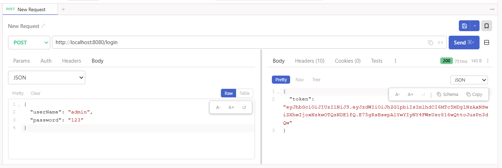
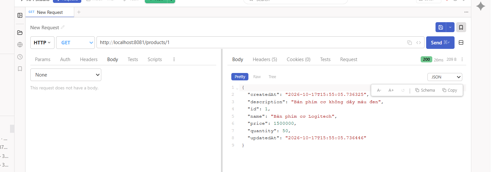
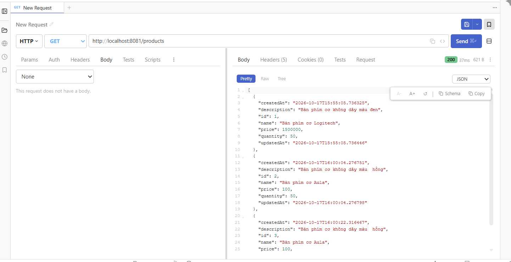
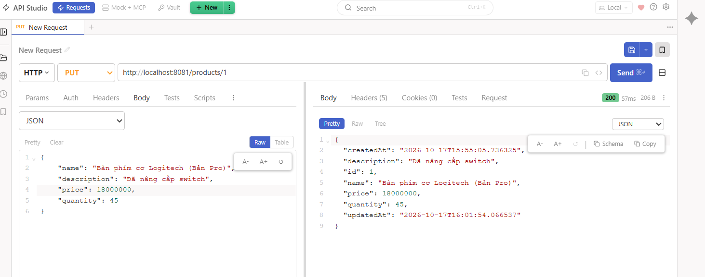

## cách chạy
```bash
cd SOA-BTH/bth2/jwt-demo
./mvnw spring-boot:run

cd SOA-BTH/bth3/productservice
./mvnw spring-boot:run
```
# ảnh chụp màn hình 
- bài thực hành số 2:




- bài thực hành số 3:






# Hướng dẫn chạy & Danh sách API (BTH2 & BTH3)

## 1. Cách chạy nhanh

* **Chạy Auth Service (BTH2 - Port 8080):**
  ```bash
  cd SOA-BTH/bth2/jwt-demo
  ./mvnw spring-boot:run
  ```

* **Chạy Product Service (BTH3 - Port 8081):**
  ```bash
  cd SOA-BTH/bth3/productservice
  ./mvnw spring-boot:run
  ```

---

## 2. Endpoints BTH2 - Auth Service (`http://localhost:8080`)

* **`POST /register`** — Đăng ký tài khoản mới (Không cần Token)
  * Body (JSON):
    ```json
    {"userName": "cuong", "password": "123"}
    ```

* **`POST /login`** — Đăng nhập lấy JWT Token (Không cần Token)
  * Body (JSON):
    ```json
    {"userName": "cuong", "password": "123"}
    ```

* **`GET /auth`** — Kiểm tra tính hợp lệ của Token (Bắt buộc Token)
  * Header: `Authorization: Bearer <token>`

---

## 3. Endpoints BTH3 - Product Service (`http://localhost:8081`)

> **Lưu ý:** Tất cả API bên dưới đều yêu cầu Header `Authorization: Bearer <token>`.

* **`GET /products`** — Lấy danh sách tất cả sản phẩm

* **`GET /products/{id}`** — Lấy thông tin chi tiết 1 sản phẩm theo ID

* **`POST /products`** — Thêm sản phẩm mới
  * Body (JSON):
    ```json
    {"name": "Laptop", "description": "Dell", "price": 25000000, "quantity": 10}
    ```

* **`PUT /products/{id}`** — Cập nhật thông tin sản phẩm theo ID
  * Body (JSON):
    ```json
    {"name": "Laptop Pro", "description": "Dell", "price": 28000000, "quantity": 5}
    ```

* **`DELETE /products/{id}`** — Xóa sản phẩm theo ID