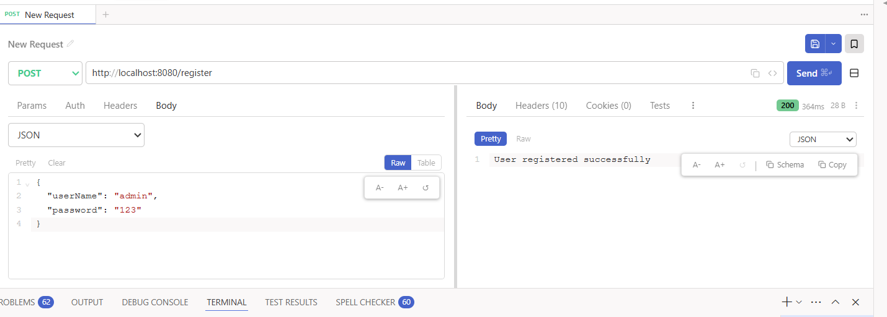

# Hướng dẫn chạy & Danh sách API (BTH2, BTH3 & BTH4)

## 1. Cách chạy nhanh

* **Chạy Auth Service (BTH2 - Port 8080):**
  ```bash
  cd SOA-BTH/bth2/jwt-demo
  ./mvnw spring-boot:run
  ```

* **Chạy Product Service (BTH3 - Port 8081):**
  ```bash
  cd SOA-BTH/bth3/productservice
  ./mvnw spring-boot:run
  ```

* **Chạy Order Service (BTH4 - Port 8082):**
  ```bash
  cd SOA-BTH/bth4/orderservice
  ./mvnw spring-boot:run
  ```

---

## 2. Endpoints BTH2 - Auth Service (`http://localhost:8080`)

* **`POST /register`** — Đăng ký tài khoản mới (Không cần Token)
  * Body (JSON):
    ```json
    {"userName": "cuong", "password": "123"}
    ```

* **`POST /login`** — Đăng nhập lấy JWT Token (Không cần Token)
  * Body (JSON):
    ```json
    {"userName": "cuong", "password": "123"}
    ```

* **`GET /auth`** — Kiểm tra tính hợp lệ của Token (Bắt buộc Token)
  * Header: `Authorization: Bearer <token>`

---

## 3. Endpoints BTH3 - Product Service (`http://localhost:8081`)

> **Lưu ý:** Tất cả API bên dưới đều yêu cầu Header `Authorization: Bearer <token>` (xác thực qua Auth Service).

* **`GET /products`** — Lấy danh sách tất cả sản phẩm

* **`GET /products/{id}`** — Lấy thông tin chi tiết 1 sản phẩm theo ID

* **`POST /products`** — Thêm sản phẩm mới
  * Body (JSON):
    ```json
    {"name": "Laptop", "description": "Dell", "price": 25000000, "quantity": 10}
    ```

* **`PUT /products/{id}`** — Cập nhật thông tin sản phẩm theo ID
  * Body (JSON):
    ```json
    {"name": "Laptop Pro", "description": "Dell", "price": 28000000, "quantity": 5}
    ```

* **`DELETE /products/{id}`** — Xóa sản phẩm theo ID

---

## 4. Endpoints BTH4 - Order Service (`http://localhost:8082`)

> **Lưu ý:** Tất cả API bên dưới đều yêu cầu Header `Authorization: Bearer <token>`. Order Service sẽ tự động gọi sang Product Service (`8081`) để kiểm tra tồn kho khi tạo đơn hàng.

### Quản lý Đơn hàng (`/orders`)

* **`GET /orders`** — Lấy danh sách tất cả các đơn hàng

* **`GET /orders/{id}`** — Lấy thông tin chi tiết một đơn hàng theo ID

* **`POST /orders`** — Tạo đơn hàng mới (Kiểm tra tồn kho sản phẩm tự động)
  * Body (JSON):
    ```json
    {
      "customerName": "Long Quoc Cuong",
      "customerEmail": "cuong4651050032@st.qnu.edu.vn",
      "status": "pending",
      "items": [
        {
          "productId": 1,
          "quantity": 2
        }
      ]
    }
    ```

* **`PUT /orders/{id}`** — Cập nhật trạng thái đơn hàng (`pending`, `completed`, `cancelled`)
  * Body (JSON):
    ```json
    {
      "status": "completed"
    }
    ```

* **`DELETE /orders/{id}`** — Xóa một đơn hàng theo ID

### Quản lý Chi tiết đơn hàng (`/order_items`)

* **`GET /order_items`** — Lấy danh sách tất cả mặt hàng trong đơn hàng

* **`GET /order_items/{id}`** — Lấy thông tin chi tiết một mặt hàng

* **`POST /order_items`** — Tạo mặt hàng mới vào đơn hàng
  * Body (JSON):
    ```json
    {
      "orderId": 1,
      "productId": 1,
      "productName": "Laptop",
      "quantity": 2,
      "unitPrice": 25000000
    }
    ```

* **`PUT /order_items/{id}`** — Cập nhật mặt hàng
  * Body (JSON):
    ```json
    {
      "quantity": 3,
      "unitPrice": 25000000
    }
    ```

* **`DELETE /order_items/{id}`** — Xóa một mặt hàng trong đơn hàng

---

# ảnh chụp màn hình 
- bài thực hành số 2:



- bài thực hành số 3:


- bài thực hành số 4:
*(Cập nhật ảnh demo BTH4 tại đây sau khi test)*