# Hướng dẫn chạy & Danh sách API (BTH2, BTH3 & BTH4)

## 1. Cách chạy nhanh

* **Chạy Auth Service (BTH2 - Port 8080):**
  ```bash
  cd SOA-BTH/bth2/jwt-demo
  ./mvnw spring-boot:run
  ```

* **Chạy Product Service (BTH3 - Port 8081):**
  ```bash
  cd SOA-BTH/bth3/productservice
  ./mvnw spring-boot:run
  ```

* **Chạy Order Service (BTH4 - Port 8082):**
  ```bash
  cd SOA-BTH/bth4/orderservice
  ./mvnw spring-boot:run
  ```

---

## 2. Endpoints BTH2 - Auth Service (`http://localhost:8080`)

* **`POST /register`** — Đăng ký tài khoản mới (Không cần Token)
  * Body (JSON):
    ```json
    {"userName": "cuong", "password": "123"}
    ```

* **`POST /login`** — Đăng nhập lấy JWT Token (Không cần Token)
  * Body (JSON):
    ```json
    {"userName": "cuong", "password": "123"}
    ```

* **`GET /auth`** — Kiểm tra tính hợp lệ của Token (Bắt buộc Token)
  * Header: `Authorization: Bearer <token>`

---

## 3. Endpoints BTH3 - Product Service (`http://localhost:8081`)

> **Lưu ý:** Tất cả API bên dưới đều yêu cầu Header `Authorization: Bearer <token>` (xác thực qua Auth Service).

* **`GET /products`** — Lấy danh sách tất cả sản phẩm

* **`GET /products/{id}`** — Lấy thông tin chi tiết 1 sản phẩm theo ID

* **`POST /products`** — Thêm sản phẩm mới
  * Body (JSON):
    ```json
    {"name": "Laptop", "description": "Dell", "price": 25000000, "quantity": 10}
    ```

* **`PUT /products/{id}`** — Cập nhật thông tin sản phẩm theo ID
  * Body (JSON):
    ```json
    {"name": "Laptop Pro", "description": "Dell", "price": 28000000, "quantity": 5}
    ```

* **`DELETE /products/{id}`** — Xóa sản phẩm theo ID

---

## 4. Endpoints BTH4 - Order Service (`http://localhost:8082`)

> **Lưu ý:** Tất cả API bên dưới đều yêu cầu Header `Authorization: Bearer <token>` (xác thực qua Auth Service cổng `8080` và kiểm tra tồn kho qua Product Service cổng `8081`).

### Quản lý đơn hàng (`/orders`)

* **`GET /orders`** — Lấy danh sách tất cả đơn hàng

* **`GET /orders/{id}`** — Lấy thông tin chi tiết 1 đơn hàng theo ID

* **`POST /orders`** — Tạo đơn hàng mới (tự động kiểm tra và trừ tồn kho)
  * Body (JSON):
    ```json
    {
      "customerName": "Long Quốc Cường",
      "customerEmail": "cuong4651050032@st.qnu.edu.vn",
      "items": [
        {"productId": 1, "quantity": 1},
        {"productId": 2, "quantity": 2}
      ]
    }
    ```

* **`PUT /orders/{id}`** — Cập nhật trạng thái đơn hàng (`pending`, `completed`, `cancelled`)
  * Body (JSON):
    ```json
    {"status": "completed"}
    ```

* **`DELETE /orders/{id}`** — Xóa đơn hàng theo ID

### Quản lý chi tiết đơn hàng (`/order_items`)

* **`GET /order_items`** — Lấy danh sách tất cả mặt hàng trong các đơn hàng

* **`GET /order_items/{id}`** — Lấy thông tin chi tiết 1 mặt hàng theo ID

* **`POST /order_items`** — Thêm mặt hàng mới vào đơn hàng có sẵn
  * Body (JSON):
    ```json
    {"orderId": 1, "productId": 3, "quantity": 1}
    ```

* **`PUT /order_items/{id}`** — Cập nhật mặt hàng trong đơn hàng
  * Body (JSON):
    ```json
    {"productId": 3, "quantity": 2}
    ```

* **`DELETE /order_items/{id}`** — Xóa mặt hàng khỏi đơn hàng


# Ảnh chụp màn hình

## Bài thực hành số 2 (Auth Service)

* **Đăng ký tài khoản (`POST /register`):**
  

* **Đăng nhập lấy JWT Token (`POST /login`):**
  

* **Kiểm tra xác thực Token (`GET /auth`):**
  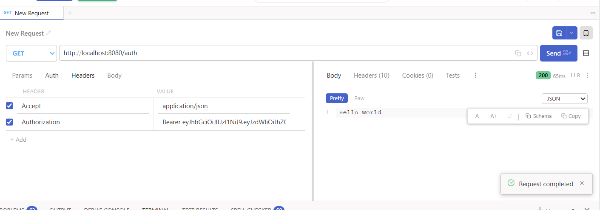

---

## Bài thực hành số 3 (Product Service)

* **Thêm sản phẩm mới (`POST /products`):**
  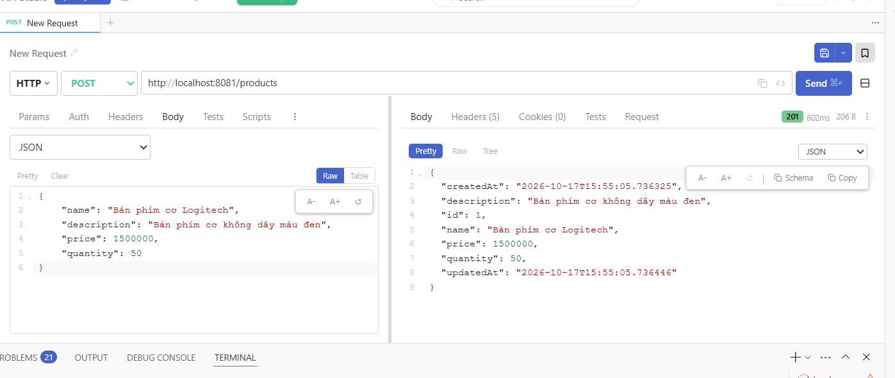

* **Lấy danh sách tất cả sản phẩm (`GET /products`):**
  

* **Lấy chi tiết một sản phẩm (`GET /products/{id}`):**
  

* **Cập nhật thông tin sản phẩm (`PUT /products/{id}`):**
  

---

## Bài thực hành số 4 (Order Service)

* **Lấy danh sách tất cả đơn hàng (`GET /orders`):**
  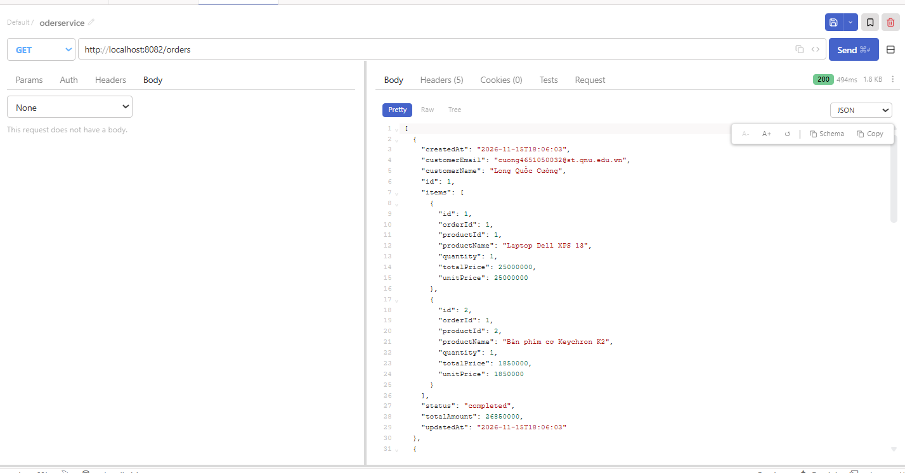

* **Lấy chi tiết một đơn hàng (`GET /orders/{id}`):**
  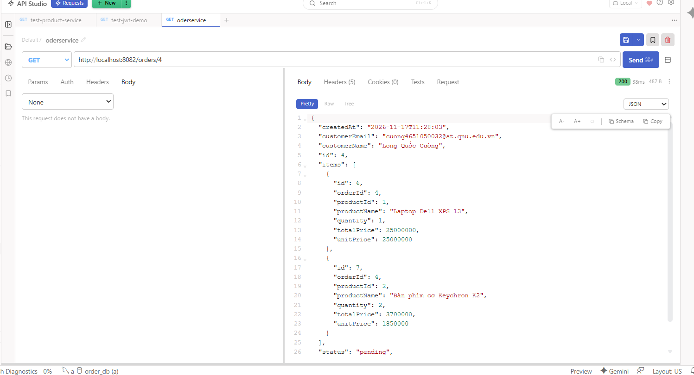

* **Cập nhật trạng thái đơn hàng (`PUT /orders/{id}`):**
  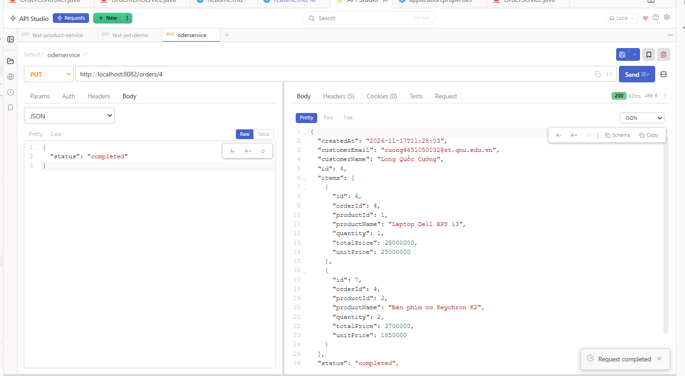

* **Xóa đơn hàng (`DELETE /orders/{id}`):**
  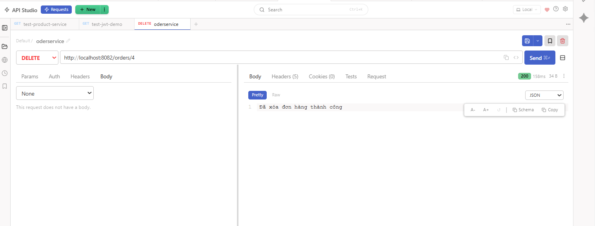

* **Lấy danh sách tất cả mặt hàng trong đơn (`GET /order_items`):**
  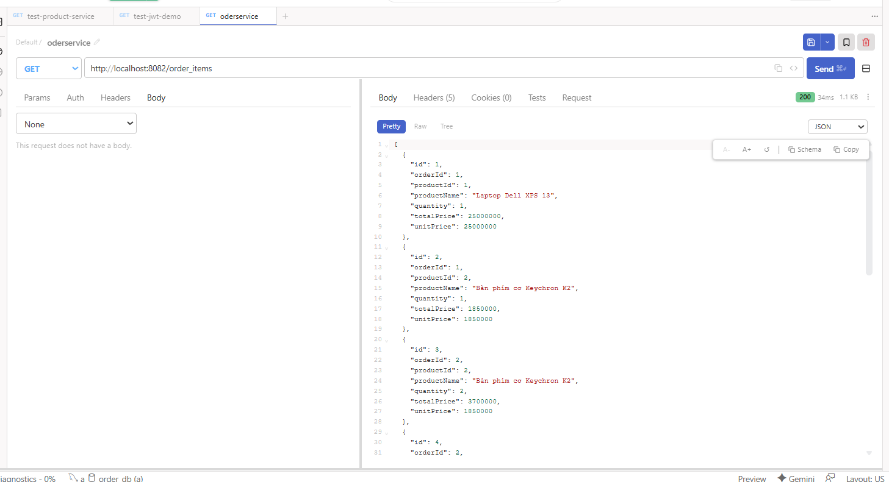

* **Lấy chi tiết một mặt hàng (`GET /order_items/{id}`):**
  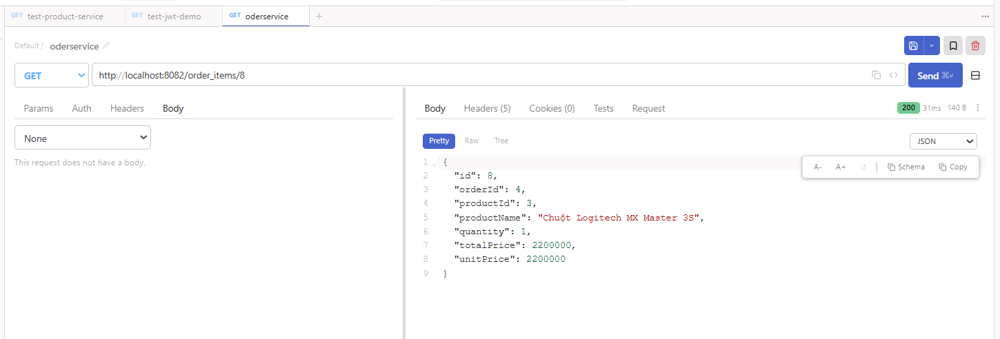

* **Thêm mặt hàng mới vào đơn hàng (`POST /order_items`):**
  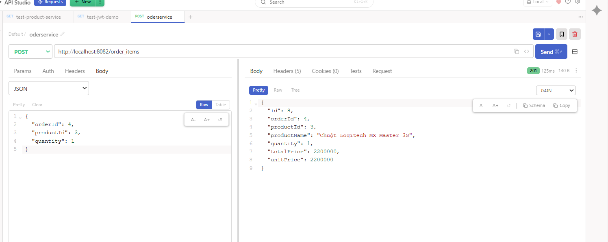

* **Cập nhật mặt hàng trong đơn hàng (`PUT /order_items/{id}`):**
  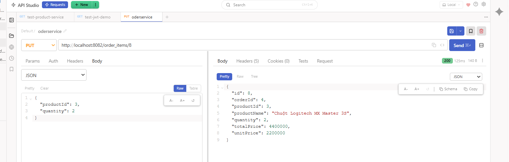

* **Xóa mặt hàng khỏi đơn hàng (`DELETE /order_items/{id}`):**
  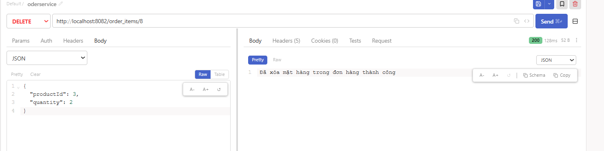